

<h1 align="center">zappex</h1>

Kanban CRM inside WhatsApp Web.

  <kbd>&nbsp;&nbsp; React&nbsp;&nbsp;</kbd> &nbsp;<kbd>&nbsp;&nbsp; TypeScript&nbsp;&nbsp;</kbd> &nbsp;<kbd>&nbsp;&nbsp; NestJS&nbsp;&nbsp;</kbd> &nbsp;<kbd>&nbsp;&nbsp; Stripe&nbsp;&nbsp;</kbd> &nbsp;<kbd>&nbsp;&nbsp; Chrome extension&nbsp;&nbsp;</kbd> &nbsp;<kbd>&nbsp;&nbsp; Vitest&nbsp;&nbsp;</kbd>

 &nbsp; 

> The source code is private; this repository documents what was built.

<table>
<tr>
<td align="center" width="33%"><b>6,086</b> passing tests</td><td align="center" width="33%"><b>Free and Pro</b> plans with billing</td><td align="center" width="33%"><b>Real Chromium</b> E2E suite with the extension</td>
</tr>
</table>

### Overview

Zappex is a Kanban CRM that runs inside WhatsApp Web as a Chrome extension. Users sign in with Google and organize the chats they already have open into columns beside the conversation. There's no QR pairing, no Meta developer account and no intermediary server speaking on the customer's behalf: the tab the user already keeps open does the talking.

It's built for professionals and small businesses that sell and support through WhatsApp and track their pipeline in their head, in a spreadsheet or on sticky notes. It solves three problems: seeing the pipeline without leaving the chat, automating follow-up (moving cards, replying, sending sequences, scheduling), and keeping the setup when they switch computers.

The central architecture rule is that the server doesn't store any conversation. It keeps configuration and each contact's pipeline position under a pseudonym. Name, company and phone are encrypted, and message text never leaves the browser.

### How it works

1. The user installs the extension and signs in with Google.
2. On first entry they accept the Terms and Privacy Policy (versioned) and acknowledge the number-block risk of automation.
3. The browser fetches the account key, derives the pseudonym and encryption keys, and the Kanban appears beside the chat.
4. Chats become cards. The user drags them between columns, tags them, edits name and company.
5. They configure automations, the send queue, auto-replies and scheduled messages.
6. The server decides when each send happens and places an order in the outbox. The browser reserves the order, resolves the `@tokens`, sends through WhatsApp Web and reports the outcome.

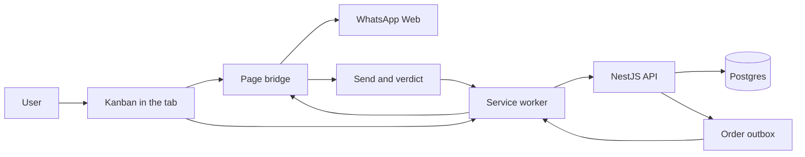

### Features in detail

#### Board (Kanban)

Columns and cards over the conversation, with drag and drop, filters, adjustable density, archiving with undo and removal from the pipeline.
- The UI uses dnd-kit; a drop persists immediately and the server returns the state.
- Changes arrive by push (a pipeline event on the executor stream), with polling as a safety net. During a drag the refetch is frozen so it cannot overwrite the gesture.
- New accounts get a set of default columns; one is the entry column where cards for new contacts land.

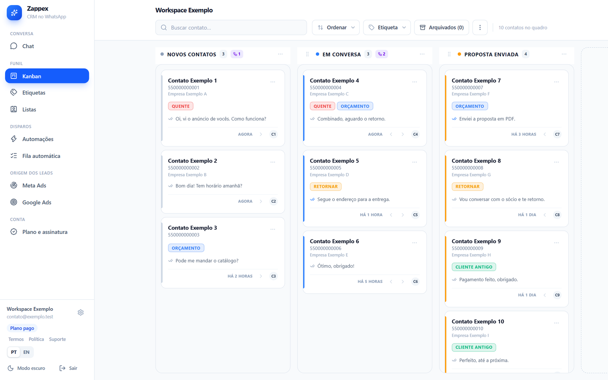 Kanban board with columns and contact cards, colored labels, a per-column automation badge and filters in the top bar.

#### Contacts, cards and labels

Each card is a contact. Name, company and phone live in a field encrypted in the browser.
- The server identifies a contact by an HMAC of the phone, never by the number.
- Manual edits to name and company persist and feed the tokens `@nome`, `@primeiro_nome`, `@empresa` and `@telefone`.
- Colored labels, applied per card, with their own manager.
- An ad click (on the WhatsApp button of the user's own site) can be matched to the contact who writes right after, by time proximity.

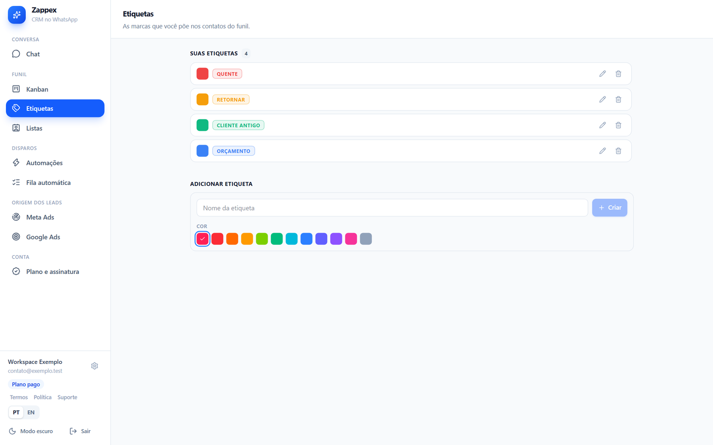 Colored label manager with create, rename and a color palette.

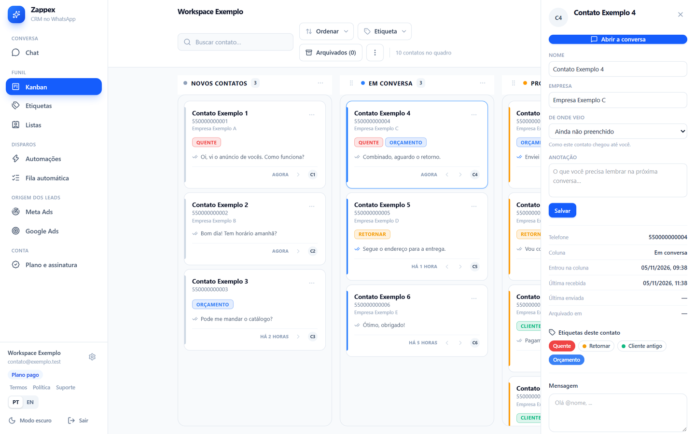 Contact drawer open over the board: name, company, source, note, dates and the labels applied to the card.

#### Contact lists

Lists imported from a spreadsheet or built from WhatsApp contacts, used as sources for the queue.
- Import reads the file in the browser, normalizes phones and merges duplicates.
- The server stores the list under the same pseudonyms.

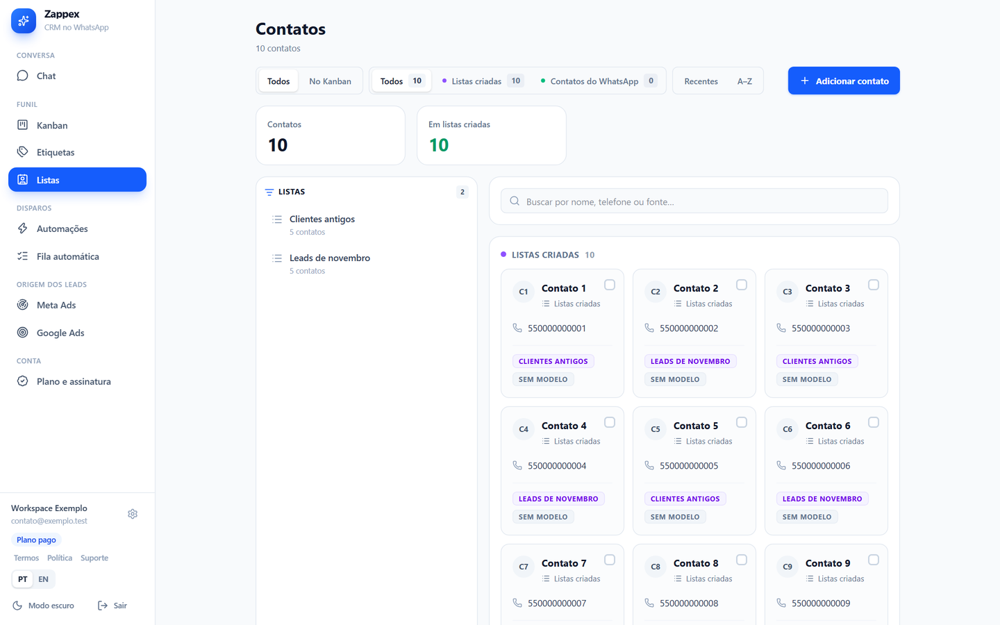 Contact lists screen: lists on the side, contacts as cards with their list and filters by source.

#### Send queue and scheduling

The automatic queue is one per workspace, with lists as switchable, orderable sources and a sequence of up to three messages with wait times. A separate hub holds one-off scheduled messages per contact.
- A sequence is all or nothing: if one order cannot be created, none is.
- Skipping a contact cancels the order nobody has reserved.
- The server hands one order at a time to the executor and enforces a per-number pause whose floor is locked server side.
- A one-off scheduled message goes out at the chosen time; queue and automations stay inside the time window.

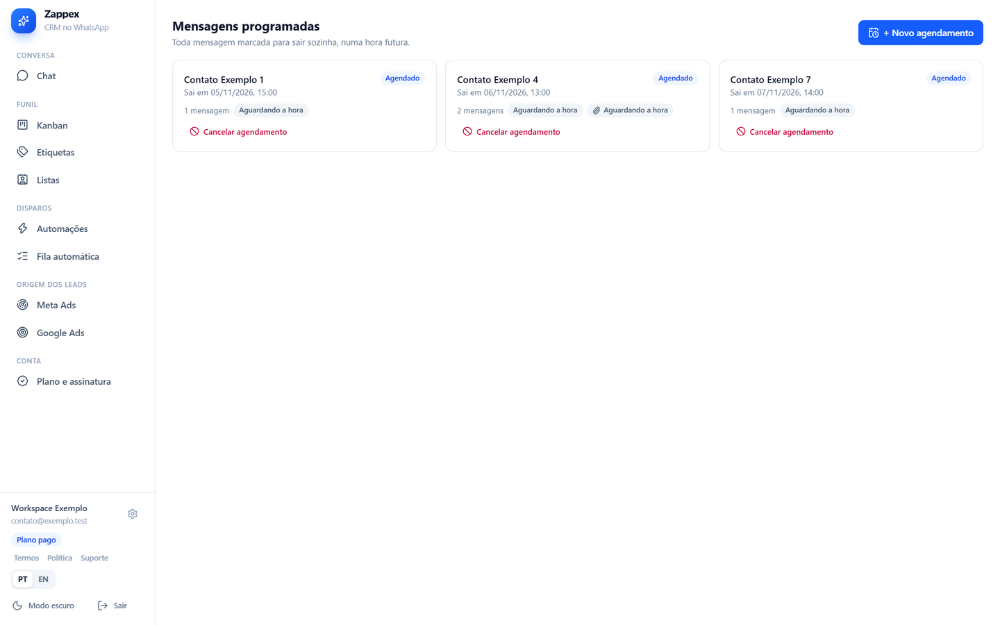 Hub of one-off scheduled messages per contact, with date, time and cancel.

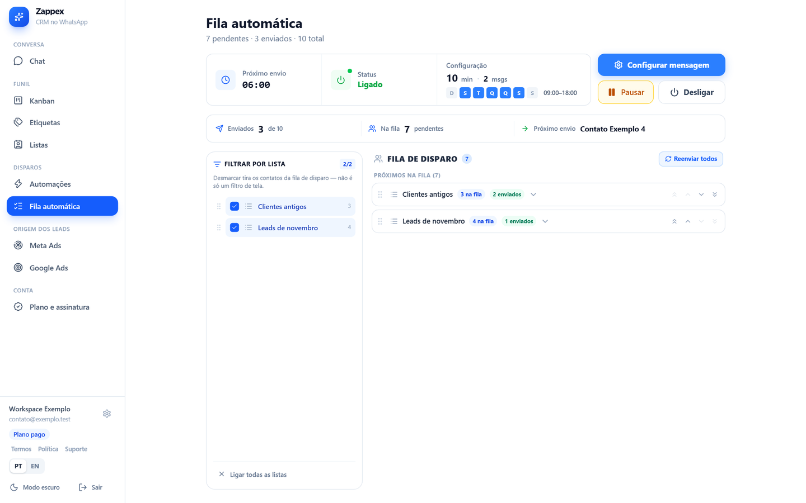 Automatic queue: status, time window, switchable and sortable lists as sources, and the next contact in line.

#### Automations and auto-replies

Trigger, delay, action. Triggers: entered column, stalled for N minutes, no reply for N, replied, keyword. Actions: send, move, send and move.
- Time-based triggers are evaluated by the server cron, which holds the timestamps.
- Keywords are compared in the browser; only a "rule matched" signal goes up.
- Moving a card works with the tab closed; sending needs an online executor.
- Auto-replies have a time window and a minimum interval per contact.

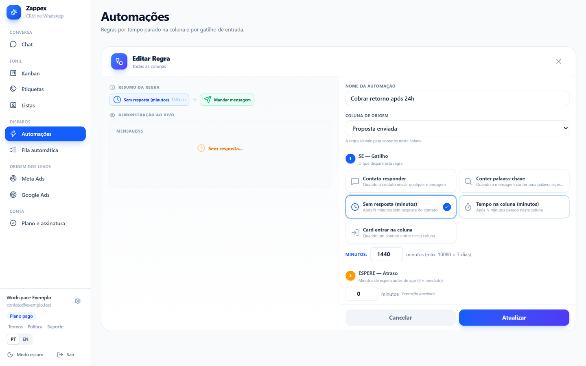 Rule editor: name, source column, trigger, delay and action, with a live preview beside it.

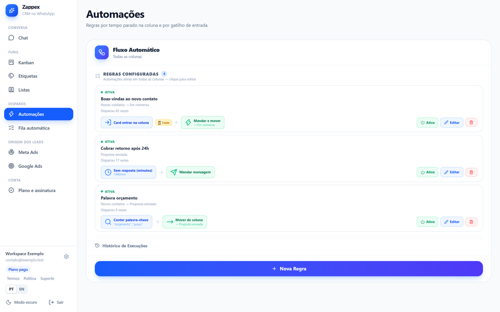 List of automation rules with trigger, delay and action, fire counts and a new-rule button.

#### Audio

Voice messages recorded on the spot or uploaded from a file, in the queue and in automations.
- The recorder uses MediaRecorder in WebM/Opus and rewraps it as Ogg/Opus in the browser, without re-encoding, because WhatsApp does not accept WebM.
- It goes out as a voice message, without a caption.
- The file is user-supplied configuration media, stored in its own table with the type checked against a closed list.

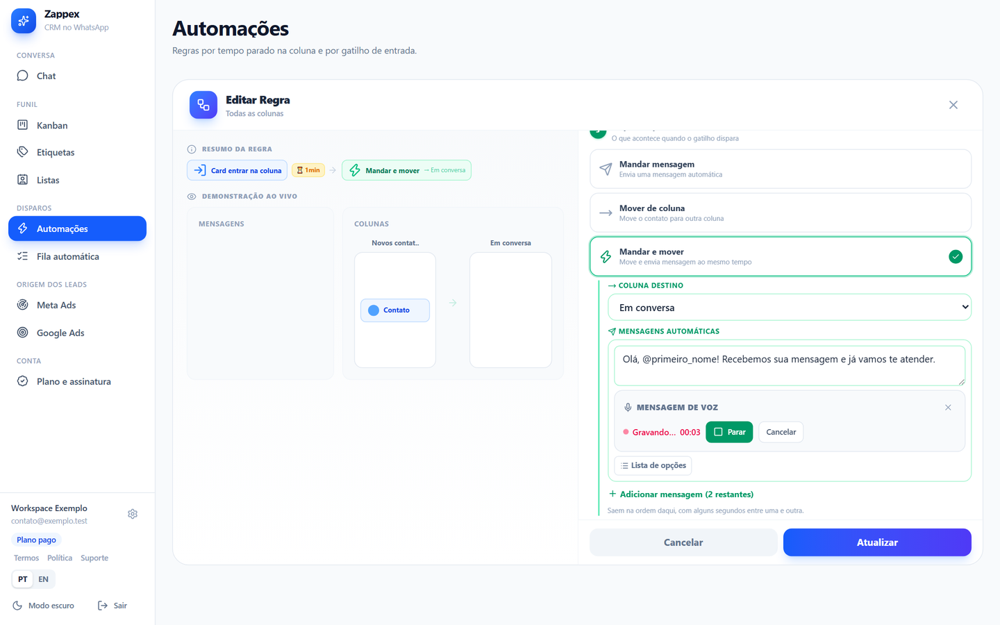 Voice message recorder inside the automation editor, recording with a timer and a stop button.

#### Quick replies

Text shortcuts for manual use, free on both plans.

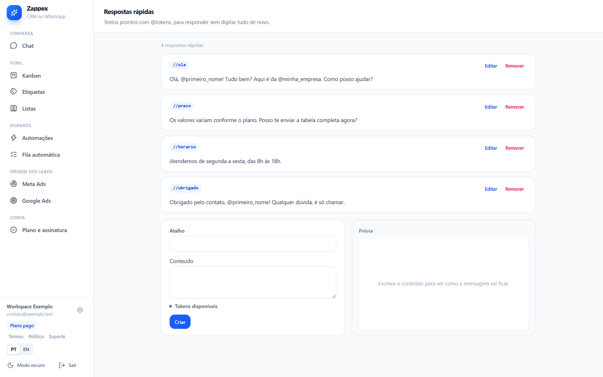 Text shortcuts with tokens such as @primeiro_nome, a creation form and a message preview.

#### Plans and billing

Free and Pro plans. Free has three columns and automations that only move cards. Pro unlocks the queue, sending automations, auto-replies and unlimited columns in practice.
- Billing through Stripe in a regular tab; no card data touches the extension.
- Card: monthly or yearly subscription with a 7-day trial, once per account and per card (only an HMAC of the card fingerprint is kept). The yearly option shows the per-month price and the savings.
- Prices live in a table and change without a deploy.
- The webhook is signed, idempotent by `event.id` and serialized per account with an advisory lock.
- Plan gating lives on the server; the padlock in the UI only informs. Losing a plan deletes nothing.

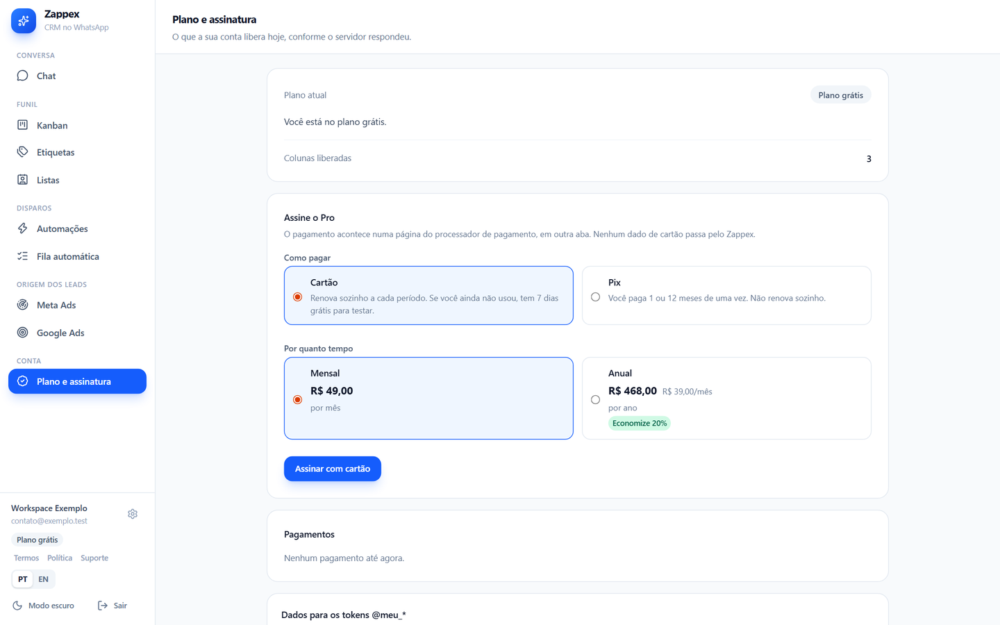 Current plan, card or Pix choice, monthly or yearly with the yearly savings, and payment history.

### Architecture

The extension has four parts: the content script (shell and Kanban, in a shadow DOM), the bridge running in the page's MAIN world beside wa-js, the service worker (named-port hub, alarms, session, ack queue) and the login popup.

The bridge authenticates with a per-load secret during the handshake and then speaks only over a private port that page scripts cannot observe. Responses go through a sanitizer before crossing the bridge.

The backend is NestJS on Fastify with Drizzle and Postgres. Modules: auth, kanban, engines, outbox, executor, billing, media, retention, health and remote config. One-minute crons run the engines. The executor stream delivers orders, pipeline notices and plan changes.

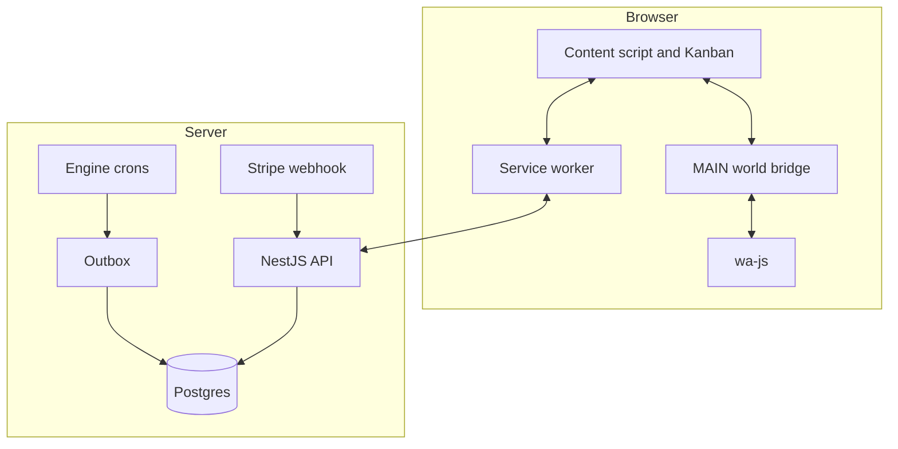

Data model, in short: account and access (users, identities, sessions, devices); pipeline (workspaces, columns, cards, labels, contacts, lists); behavior (automations, replies, queues, campaigns, scheduled messages, media); execution (outbox, queue targets); billing (subscriptions, prices, payments, events). About thirty tables in total.

### Engineering decisions

- **The server decides, the browser executes.** Caps, windows and reservation live on the server, where they apply to the whole account. Counted in the browser, a cap would double with two computers.
- **Pseudonym plus encrypted field.** `contact_ref` is an HMAC of the phone; name, company and phone travel encrypted with AES-GCM. Both keys derive from one root through HKDF with different labels.
- **Reserve and confirm in the outbox.** Orders are reserved with `FOR UPDATE SKIP LOCKED`; three timeouts sit in a fixed order: the browser gives up first, then the server's ACK window, last the reaper. Inverted, the customer would get a duplicate, and a boot-time check refuses the inversion.
- **A schema that cannot hold conversation.** A CI scan fails if any text or jsonb column is not on a justified list.
- **Plan gating on the server.** The extension can be loaded unpacked, so any client-only gate can be bypassed.
- **Webhook serialized per account.** An advisory lock inside the transaction stops two events for the same customer from racing.

### Privacy and compliance

- **Versioned acceptance:** the account records the date and version of the texts; when the text changes, the extension asks again. The send-risk notice is required only from users who turn on a sending automation.
- **Retention:** daily deletion. Message templates within 24 hours of sending; resolved orders and logs at 90 days; sessions and tokens at 7 days; deletion-cancel tokens at 30; unmatched ad clicks at 24 hours and matched ones at 180 days.
- **Export:** "Download my data" builds the file on the spot. A test fails if a new table is missing from the export or lacks a justification.
- **Deletion:** "Delete my account" disconnects devices, stops sending, turns off renewal and erases everything in 30 days, with a cancel link sent by e-mail.
- **A limit stated plainly:** the server holds the root, encrypted by a master key. Anyone with both the database and the server environment can decrypt the profiles.

### Quality

6,086 tests passing on 2026-11-05: 2,014 in the backend and 4,072 in the extension. The backend runs integration tests on in-memory Postgres with the real migrations. The E2E suite drives a real Chromium with the extension loaded and WhatsApp Web signed in, in steps covering the extension, shell, bridge, session, Kanban, queue and scheduling, with real sends only to authorized numbers. Strict lint with zero warnings, `tsc`, Prettier and a production `npm audit` run in the commit hook and in CI. Audit, QA and pentest rounds were run, and their findings became fixes with tests.

### Known limits

- Automation needs WhatsApp Web open; only card moves work with the tab closed.
- Automating WhatsApp carries a number-block risk; the product reduces it, it does not remove it.
- If wa-js breaks on a WhatsApp Web update, the extension needs adjusting.
- The Campaigns UI is frozen; the backend is still running.
- Some engine timings are marked provisional until field measurement.
- There is no automatic database backup for now.

Contact: <a href="https://joaocouto.alcetus.com">joaocouto.alcetus.com</a> · <a href="mailto:joaopecouto77@gmail.com">joaopecouto77@gmail.com</a>
