

<h1 align="center">zappex</h1>

CRM Kanban dentro do WhatsApp Web.

  <kbd> React</kbd> <kbd> TypeScript</kbd> <kbd> NestJS</kbd> <kbd> Stripe</kbd> <kbd> Chrome extension</kbd> <kbd> Vitest</kbd>

<kbd><b>Português</b></kbd> <a href="./README.en.md"><kbd>English</kbd></a>

> O código é privado; este repositório documenta o que foi construído.

<table>
<tr>
<td align="center" width="33%"><b>6.086</b> testes passando</td><td align="center" width="33%"><b>Gratuito e Pro</b> planos com cobrança</td><td align="center" width="33%"><b>Chromium real</b> suíte E2E com a extensão</td>
</tr>
</table>

### Visão geral

O Zappex é um CRM Kanban que roda dentro do WhatsApp Web, como extensão do Chrome. Quem instala cria a conta com o Google e passa a organizar, em colunas ao lado da conversa, os chats que já tem abertos. Não há QR para parear, não há conta de desenvolvedor da Meta e não há servidor intermediário falando pelo cliente: quem conversa com o WhatsApp é a aba que o usuário já deixa aberta.

O público é o profissional ou a pequena empresa que atende e vende pelo WhatsApp e hoje controla o funil de cabeça, em planilha ou em post-it. O produto resolve três problemas: ver o funil sem sair da conversa, automatizar o acompanhamento (mover card, responder, mandar sequência, agendar) e não perder a configuração ao trocar de computador.

A regra central de arquitetura é que o servidor não guarda conversa. Ele guarda a configuração e a posição de cada contato no funil, sob pseudônimo. Nome, empresa e telefone ficam cifrados, e o texto das mensagens nunca sobe.

### Como funciona

1. O usuário instala a extensão e entra com a conta Google.
2. Na primeira entrada aceita os Termos e a Política (com versão) e confirma que entende o risco de bloqueio de número ao automatizar.
3. O navegador busca a chave da conta, deriva as chaves de pseudônimo e de cifra, e o Kanban aparece ao lado do chat.
4. Os chats viram cards. O usuário arrasta entre colunas, etiqueta, edita nome e empresa.
5. Configura automações, fila de disparo, respostas automáticas e mensagens agendadas.
6. O servidor decide a hora de cada envio e coloca uma ordem na fila. O navegador reserva a ordem, interpola os `@tokens`, envia pelo WhatsApp Web e devolve o veredicto.

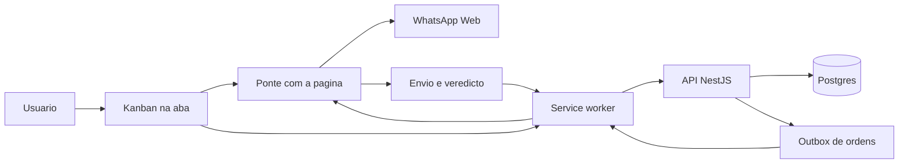

### Funcionalidades em detalhe

#### Board (Kanban)

Colunas e cards sobre a conversa, com arrasto, filtros, densidade ajustável, arquivamento com desfazer e remoção do funil.
- A tela usa dnd-kit; o drop persiste na hora e o servidor devolve o estado.
- Mudanças chegam por push (evento de funil no stream do executor), com o polling como rede de segurança. Durante um arrasto o refetch fica congelado para não sobrescrever o gesto.
- Cada coluna nova nasce numa lista fixa de colunas padrão; uma delas é a de entrada, onde cai o card de contato novo.

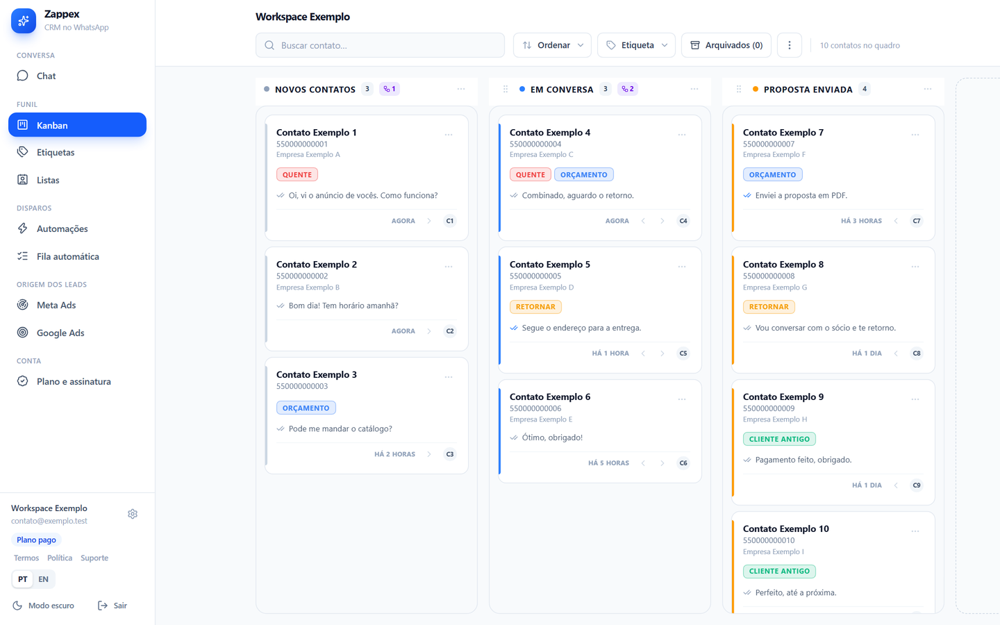 Quadro Kanban com colunas e cards de contato, etiquetas coloridas, selo de automações por coluna e filtros na barra superior.

#### Contatos, cards e etiquetas

Cada card é um contato. Nome, empresa e telefone moram num campo cifrado no navegador.
- O servidor identifica o contato por um HMAC do telefone, nunca pelo número.
- Edição manual de nome e empresa persiste, e alimenta os tokens `@nome`, `@primeiro_nome`, `@empresa` e `@telefone`.
- Etiquetas coloridas, aplicadas por card, com gerenciador próprio.
- Um sinal de anúncio (clique no botão de WhatsApp do site do usuário) pode ser casado com o contato que escreve em seguida, por proximidade de horário.

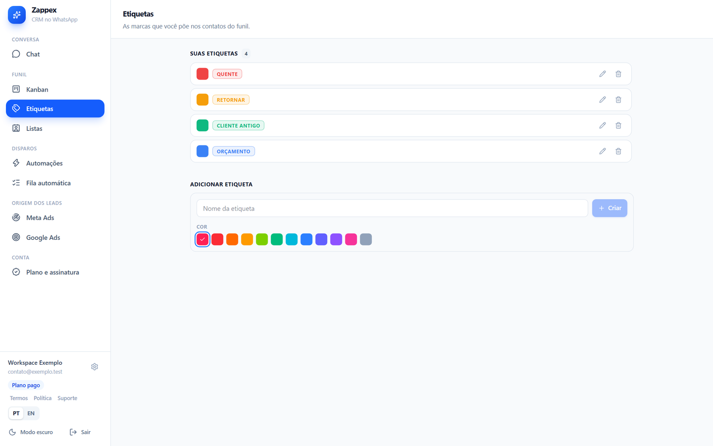 Gerenciador de etiquetas coloridas, com criação, renomeação e paleta de cores.

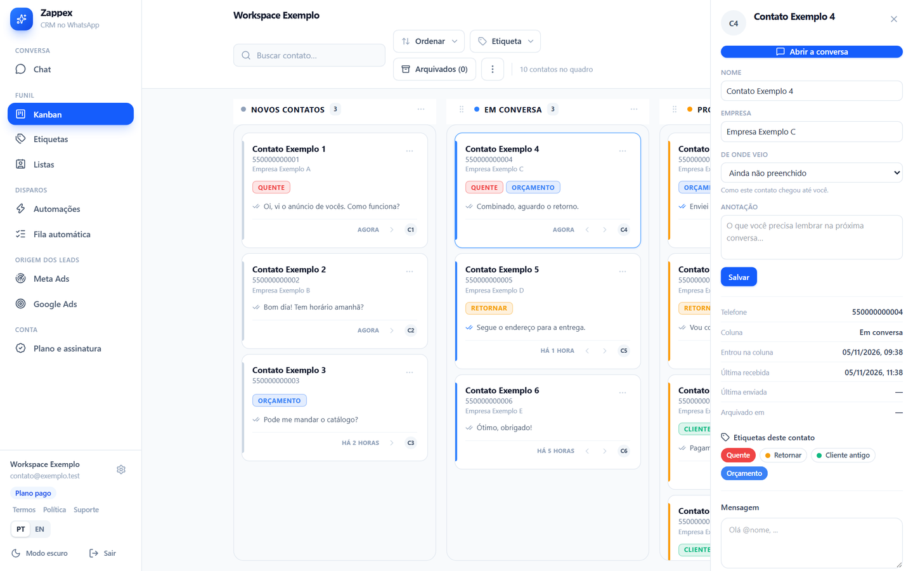 Gaveta do contato aberta sobre o quadro: nome, empresa, origem, anotação, datas e etiquetas aplicadas ao card.

#### Listas de contatos

Listas importadas de planilha ou montadas dos contatos do WhatsApp, usadas como fonte da fila.
- A importação lê o arquivo no navegador, normaliza telefones e mescla duplicados.
- O servidor guarda a lista pelos mesmos pseudônimos.

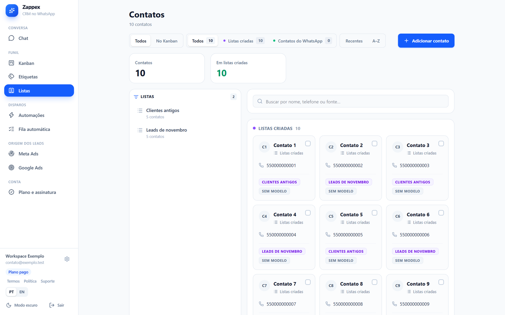 Tela de listas de contatos: listas na lateral, contatos em cards com a lista de origem e filtros por fonte.

#### Fila de disparo e agendamento

A fila automática é uma por workspace, com as listas como fontes ligáveis e ordenáveis, e uma sequência de até três mensagens com tempos de espera. Há ainda o hub de mensagens agendadas, avulsas, por contato.
- A sequência é tudo ou nada: se uma ordem da sequência não nasce, nenhuma nasce.
- Pular um contato cancela a ordem que ninguém reservou.
- O servidor entrega uma ordem por vez ao executor e respeita uma pausa por número, com piso travado no servidor.
- A mensagem agendada avulsa sai na hora marcada; fila e automação ficam presas à janela de horário.

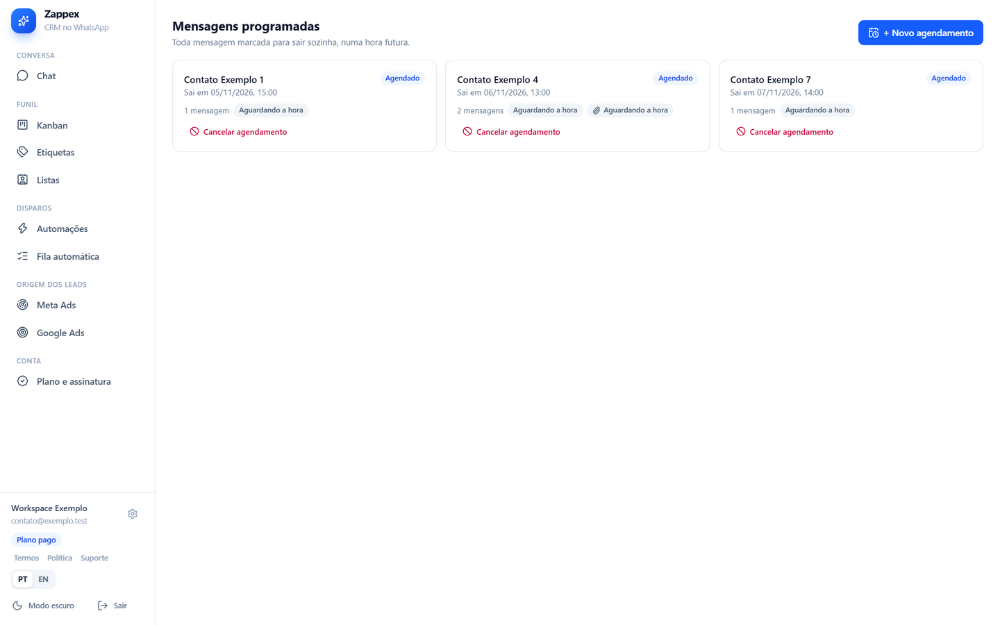 Hub de mensagens programadas, avulsas por contato, com data, hora e cancelamento.

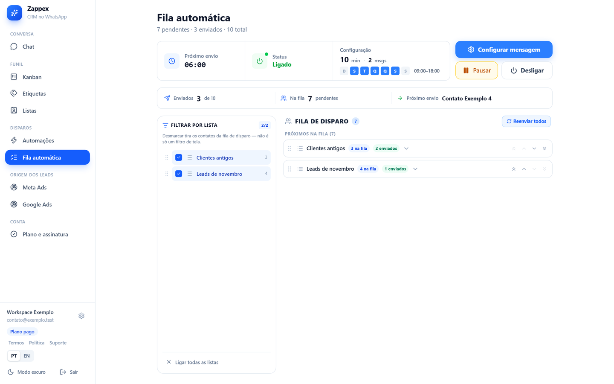 Fila automática: status, janela de horário, listas ligáveis e ordenáveis como fontes e o próximo contato a receber.

#### Automações e respostas automáticas

Gatilho, atraso e ação. Gatilhos: entrou na coluna, parado há N minutos, sem resposta há N, respondeu, palavra-chave. Ações: mandar, mover, mandar e mover.
- Os gatilhos de tempo são avaliados pelo cron do servidor, que tem os carimbos.
- A palavra-chave é comparada no navegador; sobe só o sinal "a regra bateu".
- Mover card funciona com a aba fechada; enviar exige executor online.
- Respostas automáticas têm janela e intervalo mínimo por contato.

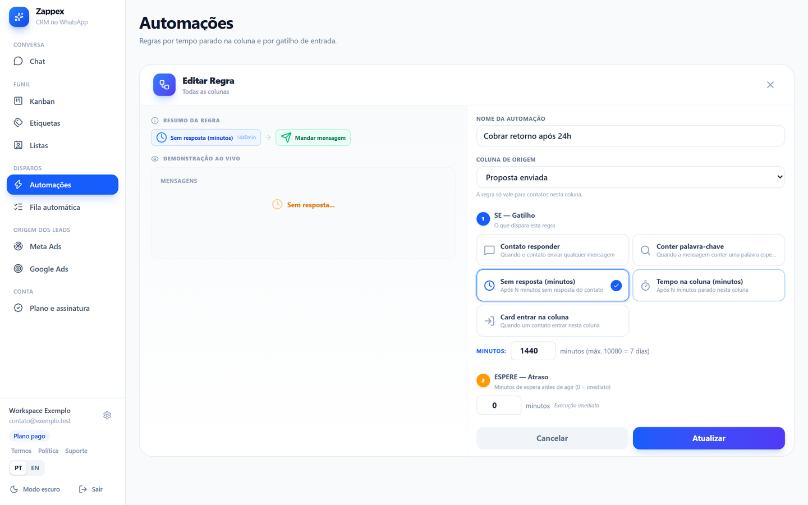 Editor de regra: nome, coluna de origem, gatilho, atraso e ação, com demonstração ao vivo ao lado.

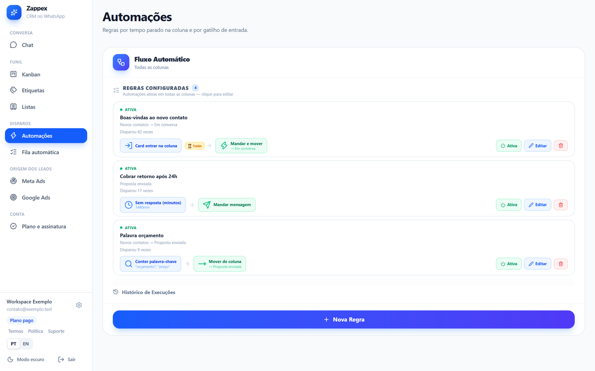 Lista de regras de automação com gatilho, atraso e ação, contagem de disparos e botão de nova regra.

#### Áudio

Mensagem de voz gravada na hora ou enviada de arquivo, na fila e nas automações.
- O gravador usa MediaRecorder em WebM/Opus e converte para Ogg/Opus no navegador, sem recodificar, porque o WhatsApp não aceita WebM.
- Sai como mensagem de voz, sem legenda.
- O arquivo é mídia de configuração do usuário e fica numa tabela própria, com tipo validado por lista fechada.

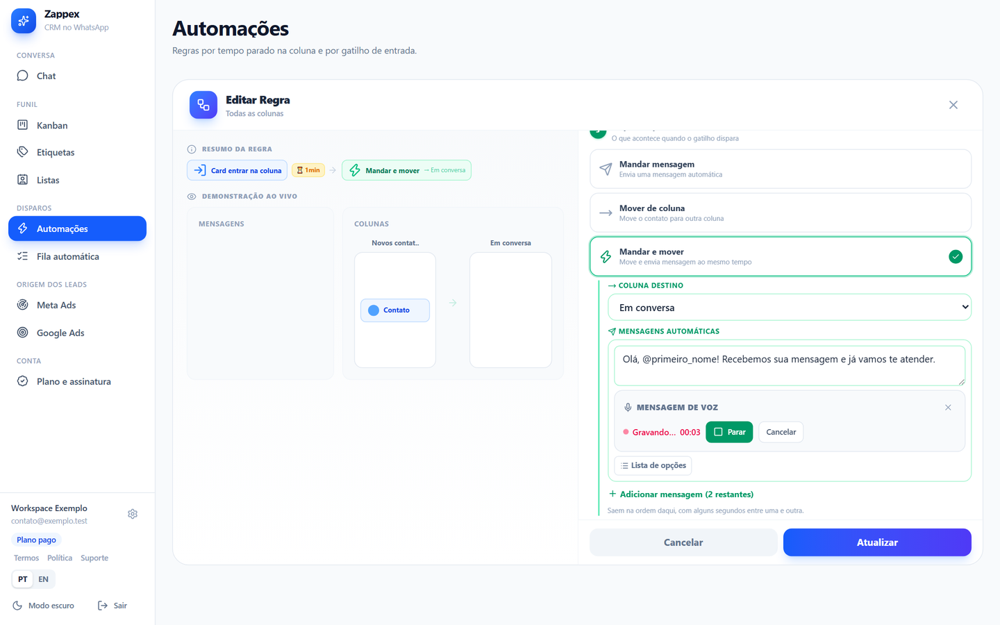 Gravador de mensagem de voz dentro do editor de automação, gravando com cronômetro e botão de parar.

#### Respostas rápidas

Atalhos de texto para uso manual, gratuitos nos dois planos.

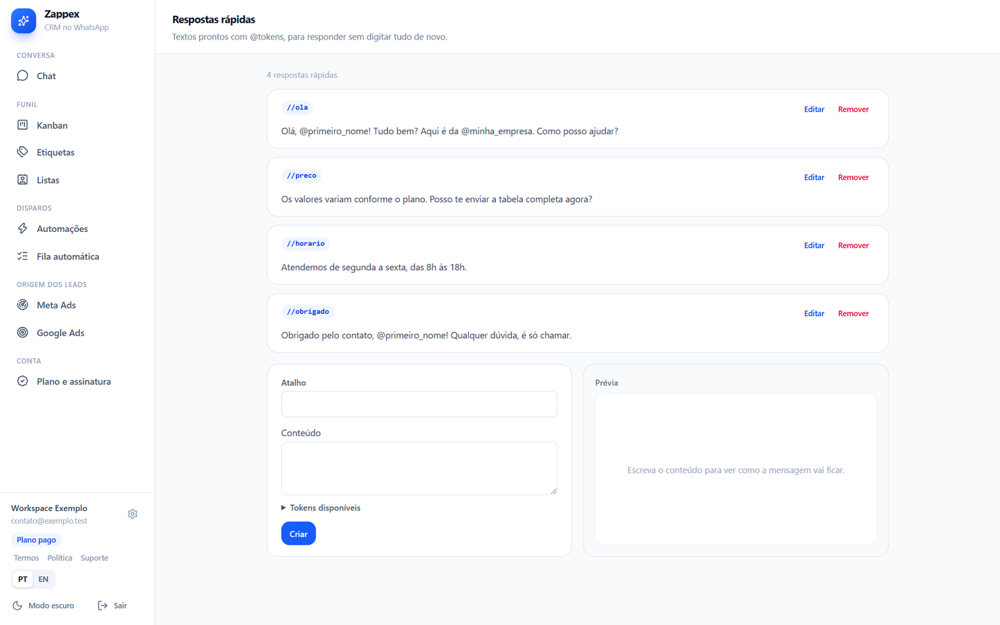 Atalhos de texto com tokens como @primeiro_nome, formulário de criação e prévia da mensagem.

#### Planos e cobrança

Plano gratuito e Pro. O grátis tem três colunas e automações que só movem card. O Pro libera fila, agendamento por automação, respostas automáticas e colunas sem limite prático.
- Cobrança pelo Stripe, em aba comum; nenhum dado de cartão passa pela extensão.
- Cartão: assinatura mensal ou anual com 7 dias de teste, uma vez por conta e por cartão (guarda-se só o HMAC da impressão do cartão). O anual mostra o valor por mês e a economia.
- O preço mora em tabela e muda sem deploy.
- O webhook é assinado, idempotente por `event.id` e serializado por conta com lock consultivo.
- A trava de plano mora no servidor; o cadeado na tela só informa. Queda de plano não apaga nada.

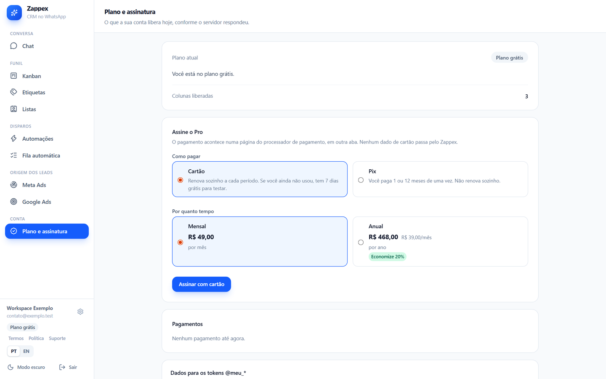 Plano atual, escolha entre cartão e Pix, mensal ou anual com a economia do anual, e histórico de pagamentos.

### Arquitetura

A extensão tem quatro partes: o content script (a casca e o Kanban, em shadow DOM), a ponte que roda no mundo MAIN da página junto do wa-js, o service worker (hub de portas nomeadas, alarmes, sessão, fila de acks) e o popup de login.

A ponte autentica por segredo de carregamento no aperto de mão e depois só fala por uma porta privada, que scripts da página não observam. Respostas passam por um sanitizador antes de cruzar a ponte.

O backend é NestJS sobre Fastify com Drizzle e Postgres. Módulos: auth, kanban, motores, outbox, executor, assinatura, mídia, retenção, saúde e config remota. Crons de um minuto rodam os motores. O stream do executor entrega ordens, avisos de funil e mudança de plano.

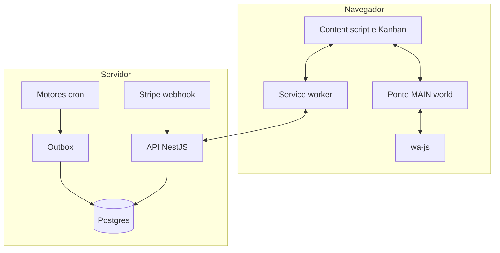

Modelo de dados, resumo: conta e acesso (usuários, identidades, sessões, dispositivos); funil (workspaces, colunas, cards, etiquetas, contatos, listas); comportamento (automações, respostas, filas, campanhas, mensagens agendadas, mídia); execução (outbox, alvos de fila); cobrança (assinaturas, preços, pagamentos, eventos). São cerca de trinta tabelas.

### Decisões de engenharia

- **Servidor decide, navegador executa.** Teto, janela e reserva ficam no servidor, onde valem para a conta inteira. Contado no navegador, o teto dobraria com dois computadores.
- **Pseudônimo mais campo cifrado.** `contact_ref` é HMAC do telefone; nome, empresa e telefone viajam cifrados com AES-GCM. As duas chaves saem da mesma raiz por HKDF com rótulos diferentes.
- **Reserva e confirmação no outbox.** Ordem reservada com `FOR UPDATE SKIP LOCKED`; três tempos em ordem fixa: o navegador desiste primeiro, depois a janela de ACK do servidor, por último o reaper. Invertida, o cliente receberia mensagem duplicada, e uma verificação no boot recusa a inversão.
- **Esquema que não aceita conversa.** Uma varredura no CI falha se uma coluna de texto ou jsonb não estiver numa lista justificada.
- **Trava de plano no servidor.** A extensão pode ser instalada descompactada; qualquer gate só no cliente é contornável.
- **Webhook serializado por conta.** Lock consultivo na transação evita que dois eventos do mesmo cliente se atropelem.

### Privacidade e conformidade

- **Aceite com versão:** a conta grava data e versão dos textos; mudou o texto, a extensão pede novo aceite. O aviso de risco de envio é cobrado só de quem liga uma automação que envia.
- **Retenção:** apagamento diário. Modelo de texto em até 24 horas após o envio; ordens resolvidas e logs em 90 dias; sessões e tokens em 7 dias; token de cancelamento de exclusão em 30; clique de anúncio sem vínculo em 24 horas e com vínculo em 180 dias.
- **Exportação:** "Baixar meus dados" gera o arquivo na hora. Um teste falha se uma tabela nova ficar fora do export ou sem justificativa.
- **Exclusão:** "Apagar minha conta" desconecta dispositivos, para os envios, desliga a renovação e elimina tudo em 30 dias, com link de cancelamento por e-mail.
- **Limite dito em voz alta:** o servidor guarda a raiz cifrada pela chave mestra. Quem tiver banco e ambiente ao mesmo tempo decifra os perfis.

### Qualidade

6.086 testes passando em 05/11/2026: 2.014 no backend e 4.072 na extensão. O backend roda integração com Postgres em memória e migrations reais. A suíte E2E dirige um Chromium real, com a extensão carregada e o WhatsApp Web logado, em passos que cobrem extensão, casca, ponte, sessão, Kanban, fila e agendamento, com disparo só para números autorizados. Lint estrito com zero aviso, `tsc`, Prettier e `npm audit` de produção rodam no hook de commit e no CI. Houve rodadas de auditoria, QA e pentest; os achados viraram correções com teste.

### Limites conhecidos

- A automação exige o WhatsApp Web aberto; só mover card funciona com a aba fechada.
- Automatizar o WhatsApp tem risco de bloqueio de número; o produto reduz, não elimina.
- Se o wa-js quebrar numa atualização do WhatsApp Web, a extensão precisa de ajuste.
- A UI de Campanhas está congelada; o backend segue de pé.
- Alguns tempos do motor são marcados como provisórios até a medição de campo.
- Sem backup automático do banco por enquanto.

Contato: <a href="https://joaocouto.alcetus.com">joaocouto.alcetus.com</a> · <a href="mailto:joaopecouto77@gmail.com">joaopecouto77@gmail.com</a>
